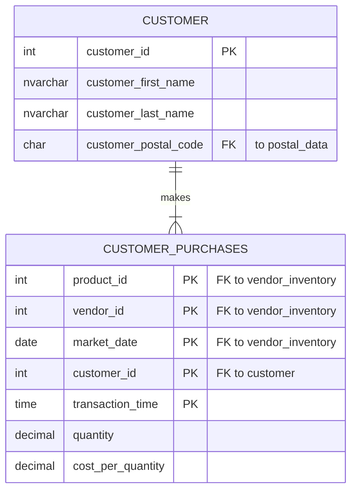

# Assignment 1 – Logical Data Model

Tables: `customer` and `customer_purchases` (farmersmarket.db)

Relationship: **one-to-many**. Each customer makes one or many purchases.
Each purchase row belongs to exactly one customer, joined on `customer_id`.

| From | To | Join column | Type |
|---|---|---|---|
| customer | customer_purchases | customer_id | One (1) to one-or-many (1..N) |

Notes:

- Relationship type checked in the data: every customer_id in `customer`
  appears in `customer_purchases` (query returned 0 customers with no purchases).
- `customer_purchases` has a composite primary key:
  product_id, vendor_id, market_date, customer_id and transaction_time.
- `customer_postal_code` links to `postal_data`.
  `product_id`, `vendor_id` and `market_date` link to `vendor_inventory`.
  Those tables are outside this two-table model.
